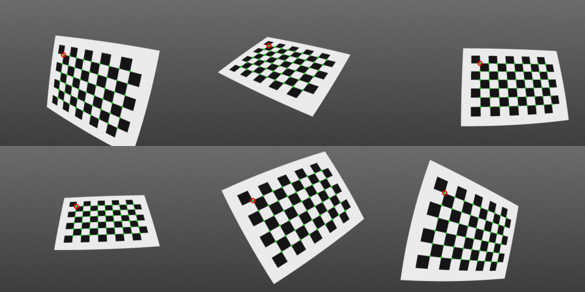
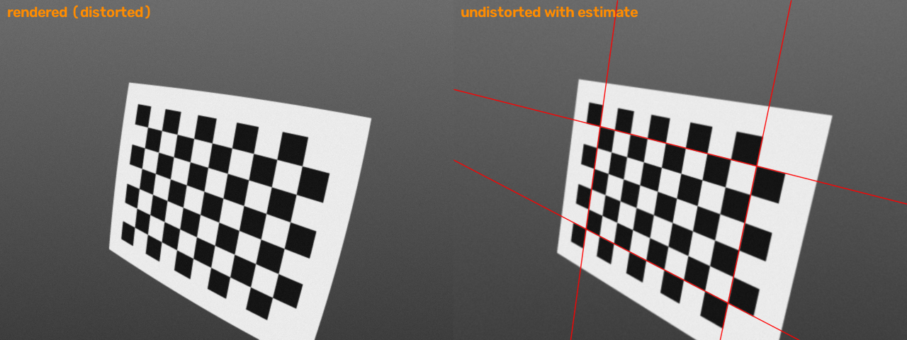
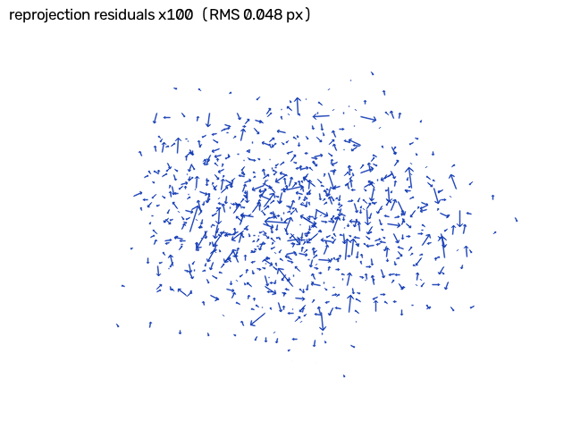

# cv-zhang-calib

Camera intrinsic calibration from a planar checkerboard — Zhang's method
(Z. Zhang, *A Flexible New Technique for Camera Calibration*, PAMI 2000) —
implemented from scratch in numpy, including Brown-Conrady lens distortion,
a block-structured Levenberg-Marquardt refinement and parameter uncertainties.

The test scenes are **ray-traced procedurally** through a known distorted camera,
so every number below can be checked against ground truth, and the repo ships no
image data.



## What's inside

| File | What it does |
|---|---|
| `calib/camera.py` | Pinhole + radial/tangential distortion (OpenCV convention), Rodrigues both ways (incl. the θ≈π branch), fixed-point undistortion |
| `calib/zhang.py` | Normalised-DLT homographies → closed-form K from the image of the absolute conic (with skew) → per-view [R\|t] projected onto SO(3) → linear k1,k2 → LM over 8 intrinsics + 6N pose params → σ²(JᵀJ)⁻¹ standard errors |
| `calib/render.py` | Board geometry, random tilted poses kept fully in view, a 3×3-supersampled ray tracer through the distorted lens, OpenCV corner detection + sub-pixel refinement, image undistortion |
| `demo.py` | Full pipeline on 15 rendered views, compared with ground truth and `cv2.calibrateCamera`; writes the figures in `output/` |
| `tests/test_calib.py` | 17 tests (below) |

OpenCV is used only to *find* the corners in the rendered images (and as an
independent reference in one test). Every calibration step is this repo's code.

### The math, briefly

Each view's homography `H = λ K [r1 r2 t]`. Because `r1 ⊥ r2` and `|r1| = |r2|`,
every view gives two linear equations in the six entries of the symmetric
`B = K⁻ᵀK⁻¹`: `h1ᵀBh2 = 0` and `h1ᵀBh1 − h2ᵀBh2 = 0`. Three or more tilted views
pin `B` down up to scale (the SVD null vector), and K comes out of `B` in closed
form. That estimate ignores distortion, so it is only a starting point — with
k1 = −0.28 it is a few percent off — and the LM refinement over the full
projection model does the rest. Boards that are all parallel to the sensor make
the constraint matrix rank-deficient; that case is detected and raised rather
than returning NaNs.

## Run it

```bash
pip install -r requirements.txt
python3 demo.py          # ~5 s on a laptop CPU
python3 -m pytest -q     # ~5 s
```

## Sample output (pasted from an actual run)

Ground truth: 640×480, fx = 520, fy = 515, c = (322.5, 236.8),
k1 = −0.28, k2 = 0.09, p1 = 0.0012, p2 = −0.0008. Rendered images get a 0.6 px
Gaussian blur and σ = 2 grey-level noise.

```
Rendered 15 views at 640x480, board found in 15
Corner detection error vs ground truth: RMS 0.0705 px, max 0.2703 px

Closed-form (Zhang, distortion ignored):
  fx=502.599 fy=488.476 skew=-4.346 cx=319.627 cy=244.447

After Levenberg-Marquardt (this repo):
  fx =   520.080389  +/- 0.184785
  fy =   515.047565  +/- 0.169674
  cx =   323.109587  +/- 0.330754
  cy =   236.324384  +/- 0.251093
  k1 =    -0.278632  +/- 0.001167
  k2 =     0.085966  +/- 0.004884
  p1 =     0.001087  +/- 0.000081
  p2 =    -0.000801  +/- 0.000071
  RMS reprojection error = 0.0484 px (10 LM iterations)

  param   ground truth        this repo    cv2.calibrateCamera   |err|/sigma
     fx     520.000000       520.080389       520.080389           0.44
     fy     515.000000       515.047565       515.047565           0.28
     cx     322.500000       323.109587       323.109588           1.84
     cy     236.800000       236.324384       236.324384           1.89
     k1      -0.280000        -0.278632        -0.278632           1.17
     k2       0.090000         0.085966         0.085966           0.83
     p1       0.001200         0.001087         0.001087           1.40
     p2      -0.000800        -0.000801        -0.000801           0.02
  RMS (px)                      0.048420         0.068476

Board-centre position error across views: mean 0.641 mm, max 0.778 mm

Accuracy vs number of views (output/views_sweep.csv):
  views,fx_err_pct,fy_err_pct,cx_err_px,cy_err_px,k1_err,rms_px
  3,0.0263,0.0412,0.3720,0.6432,0.00324,0.0603
  6,0.0399,0.0332,0.4216,0.6472,0.00001,0.0543
  9,0.0452,0.0246,0.1566,0.5820,0.00095,0.0489
  12,0.0105,0.0064,0.4332,0.3127,0.00062,0.0451
  15,0.0155,0.0092,0.6096,0.4756,0.00137,0.0484

Wrote output/views.png, output/undistort.png, output/residuals.png, output/views_sweep.csv
```

Notes on reading it:

* **This repo and OpenCV agree to 6 decimals** on every parameter from the same
  correspondences — an independent check on the implementation.
* OpenCV's RMS is `sqrt(Σ|r|² / n_points)`; this repo averages over the x and y
  residuals separately, so OpenCV's number is exactly √2 larger.
* `|err|/sigma` compares the error against ground truth with the standard error
  the calibration reports for itself; values in the 0–2 range mean the reported
  uncertainty is honest.
* The remaining error is dominated by corner localisation (~0.07 px RMS), not by
  the solver: on noiseless points the solver recovers every parameter to 1e-5.



Straight lines through the outermost corner rows and columns hug the board edges
only after the estimated distortion has been removed.



## Tests

Expected values come from geometry, never from this code's own output:

* Rodrigues: a quarter turn about z gives the textbook matrix; round trips at
  θ≈0, θ≈π and general angles; orthonormality and det = 1.
* Distortion: the radial formula checked by hand at (0.3, −0.4); distort →
  undistort round trip to 1e-10; undistorted pixels equal an ideal pinhole projection.
* DLT recovers the exact homography `K[r1 r2 t]` on noiseless points.
* Closed-form Zhang recovers a K **with skew** to 1e-9 relative, and each
  view's R (to 1e-6°) and t, from exact homographies.
* Fewer than 3 views, fronto-parallel boards and non-planar points are rejected.
* Noiseless points: all 8 intrinsics and all 15 poses recovered (fx to 1e-5 px).
* σ = 0.25 px noise: every parameter within 4σ of truth using the *reported*
  standard errors, and residual RMS matches the least-squares expectation
  `σ·sqrt(1 − p/m)` to 6%.
* Identical to `cv2.calibrateCamera` (rtol 1e-5) on the same noisy points, and
  OpenCV's RMS is √2 × ours to 1e-4.
* End to end on rendered images: sub-pixel corner detection (< 0.15 px RMS),
  focal length within 0.3%, principal point within 2 px, k1 within 0.01.

```
$ python3 -m pytest -q
.................                                                        [100%]
17 passed
```

Verified on Python 3.10.12, numpy 2.2.6, OpenCV 5.0.0, pytest 9.1.1.

## License

MIT
